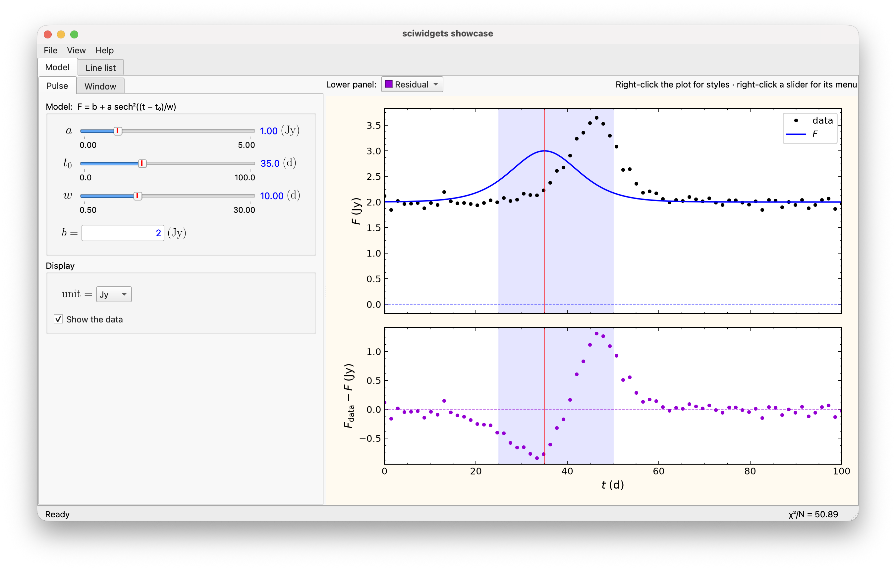

# Documentation figures

`sciwidgets.devtools` takes an app's documentation pictures and animated GIFs
with scripts, so they can be retaken in one command whenever the app changes.
It needs Pillow (installed with Matplotlib); on macOS, pictures with the
window's title bar and shadow also need `pyobjc-framework-Quartz` (in the
`dev` extra) and Screen Recording permission for the terminal (System
Settings → Privacy & Security → Screen & System Audio Recording).



## A tool file

Each app has a small file listing what it wants:

```python
# tools/figures.py
from sciwidgets.devtools import Gif, Shot, main


def solved(p):
    """The main window after the first solve."""
    yield from p.wait_until(lambda: p.win.results)


def tour(p):
    """Drag a slider, then switch to dark mode."""
    yield from p.drag_slider(p.win.panel.get_widget("pulse.a"), 1.6, 0.9)
    yield from p.open_menu("View")
    yield from p.choose("Dark Theme")
    yield 1.0


SHOTS = {"main_window": Shot("myapp", solved, size=(1400, 760))}
GIFS = {"tour": Gif("myapp", tour, width=900)}

if __name__ == "__main__":
    raise SystemExit(main(SHOTS, GIFS))
```

```bash
python tools/figures.py                   # everything, into docs/figures
python tools/figures.py main_window       # one item
python tools/figures.py main_window --dark   # main_window_dark.png
python tools/figures.py --pictures        # only the pictures (--gifs: only the animations)
python tools/figures.py --list
```

Each item runs in a fresh Python process with empty settings, so your own
saved settings (recent files, plot styles) never show in the pictures.

## Shot and Gif

| `Shot(...)` | Meaning |
|-------------|---------|
| `start` | module run as `python -m start`, or a function that starts the app (and runs `app.exec()`) |
| `script` | brings the app into the state to show (see below); `None`: as it opens |
| `file` | file name; default `<name>.png` |
| `shadow` | keep the window shadow (macOS) |
| `composite` | grab the window with Qt and paste open menus and dialogs in (no title bar): for a picture of a menu |
| `target` | `"window"` or `"dialog"` (the dialog open at the end of the script) |
| `both` | light and dark side by side |
| `size` | resize the main window first, `(width, height)` |
| `capture` | a function `(player, path)` that takes the picture itself, e.g. arranging several windows |

`Gif(start, script, file=None, width=900, size=None)` records the script
while it plays: about 20 frames a second, menus and dialogs pasted in at
their place, a mouse pointer drawn, saved as a looping GIF.

## Scripts

A script is a function of a `Player` that yields waits in seconds between
actions. `p.win` is the app's main window and `p.app` the application. The
events go to the windows directly, so the computer can be used while a GIF
records.

| Action | Does |
|--------|------|
| `yield from p.wait_until(condition)` | wait until `condition()` is true, e.g. a solve finished |
| `yield from p.move(point, seconds)` | glide the mouse (`p.at(widget, fx, fy)` gives a point of a widget) |
| `p.click()`, `p.press()`, `p.release()`, `p.right_click()` | mouse buttons where the mouse is |
| `yield from p.drag_slider(slider, value)` | drag a slider to a value (or `fraction=` of its groove) |
| `yield from p.choose("Set Value...")` | choose an item of the open menu (a submenu opens) |
| `yield from p.open_menu("View")` | open a menu of the menu bar |
| `yield from p.type_in_dialog("7", None, "20")` | type into the open dialog's fields |
| `yield from p.press_button("OK")` | click a button of the open dialog |
| `yield from p.select(combo, "R")` | choose a combo-box entry |
| `p.trigger("Export Plot...")` | trigger a menu action without showing the menu |

Without a title bar or shadow, `capture(widget, path)` and
`side_by_side(paths, out)` are also there for a `capture` function of your
own. The repo's `tools/figures.py` is a complete example.
