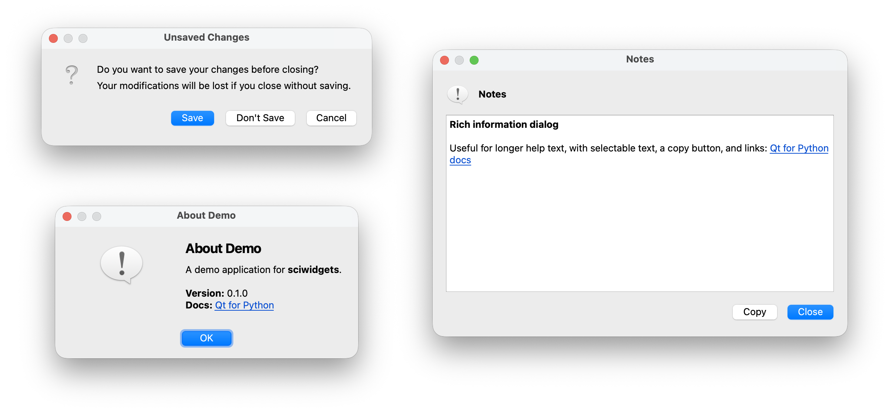

# Dialogs

Ready-made dialogs for messages, questions and longer information, with a
consistent look. Import them from `sciwidgets.dialogs`. Each function opens a
modal dialog and returns when the user closes it.



Run `python -m sciwidgets.dialogs` to see every dialog.

## Messages

```python
from sciwidgets.dialogs import show_critical, show_information, show_warning

show_information("Export", "The results were exported.", parent=window)
show_warning(
    "Overwrite File",
    "A file with this name already exists.",
    "Saving now will replace the existing file.",
    parent=window,
)
show_critical("Load Error", "The selected file could not be opened.", parent=window)
```

All three take `(title, text, informative_text="", parent=None)`. `text` is
the main message; `informative_text` is an optional second, smaller
paragraph. Both accept simple HTML (`<b>`, `<code>`, links) and `\n` for line
breaks.

Pass `parent` whenever you have a window: the dialog then opens centered over
it, and on macOS it belongs to that window.

## Questions

```python
from sciwidgets.dialogs import AskResult, ask_question

result = ask_question(
    "Unsaved Changes",
    "Do you want to save your changes before closing?",
    "Your changes will be lost if you don't save them.",
    yes_btn_label="Save",
    no_btn_label="Don't Save",
    parent=window,
)
if result == AskResult.YES:
    save()
elif result == AskResult.NO:
    close_without_saving()
# AskResult.CANCEL: do nothing
```

| Argument | Default | Meaning |
|----------|---------|---------|
| `yes_btn_label` | `"Yes"` | Text of the default button |
| `no_btn_label` | `None` | Text of a second answer; `None` leaves only *Yes* and *Cancel* |
| `cancel_btn_label` | `"Cancel"` | Text of the cancel button |

The result is `AskResult.YES`, `AskResult.NO` or `AskResult.CANCEL`. Closing
the window also counts as *Cancel*.

## Longer information

`show_rich_information` shows HTML in a scrollable, resizable window with
selectable text and a *Copy* button, which suits help text, data summaries or
logs:

```python
from sciwidgets.dialogs import show_rich_information

show_rich_information(
    "Fit Summary",
    "<b>χ² = 1.03</b><br>12 parameters, 340 data points<br>"
    '<a href="https://example.org/docs">Documentation</a>',
    parent=window,
)
```

Optional arguments: `icon` (a `DialogIcon`, or `None` for no icon) and
`copy_button=False` to hide the *Copy* button.

## About dialog

```python
from sciwidgets.dialogs import show_about_dialog

show_about_dialog(
    "About My App",
    "Version 1.2<br>"
    '<a href="https://github.com/me/my-app">GitHub</a>',
    heading="My App",
    parent=window,
)
```

The icon on the left is your application icon. Set it once at startup with
`app.setWindowIcon(QIcon("icon.png"))` and every dialog uses it; or pass a
`QIcon` as `icon=` for this dialog only. Without either, a standard
information icon is shown.

## Building your own dialog

`TitledDialogBase` gives you the same header (title, text, optional icon) and
lets you add your own widgets below it:

```python
from PySide6.QtWidgets import QComboBox, QDialogButtonBox
from sciwidgets.dialogs import DialogIcon, TitledDialogBase


class ChooseSourceDialog(TitledDialogBase):
    def __init__(self, sources, parent=None):
        super().__init__(
            title="Select Source",
            text="Several sources were found.",
            icon=DialogIcon.QUESTION,
            parent=parent,
        )
        self.combo = QComboBox()
        self.combo.addItems(sources)
        buttons = QDialogButtonBox(QDialogButtonBox.Ok | QDialogButtonBox.Cancel)
        buttons.accepted.connect(self.accept)
        buttons.rejected.connect(self.reject)
        self.add_widget(self.combo)
        self.add_widget(buttons)
```

Use `add_widget`, `add_layout` and `add_stretch` to fill the body.
`DialogIcon` offers `INFORMATION`, `WARNING`, `CRITICAL` and `QUESTION`.
