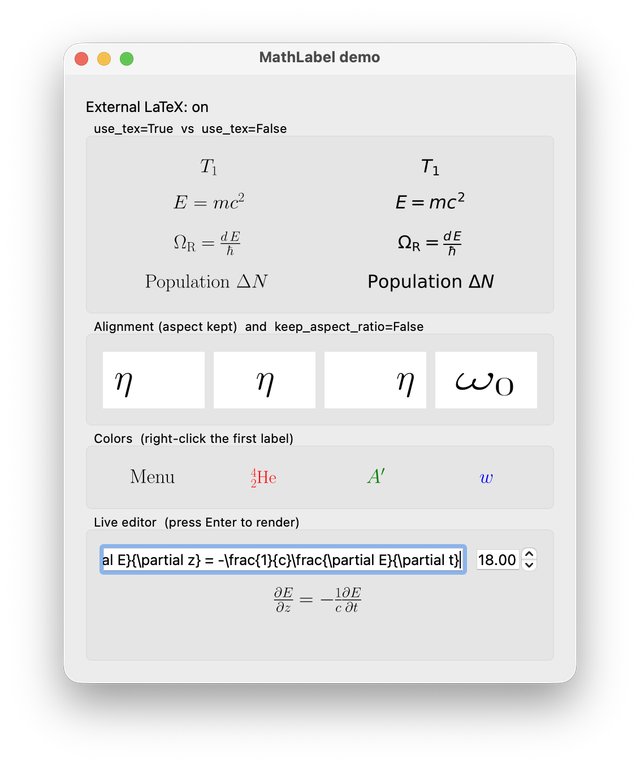

# Labels

`MathLabel` displays a math expression rendered by Matplotlib. It behaves like
a `QLabel` and is used for slider names, units and formulas throughout
sciwidgets. Import it from `sciwidgets.labels`.

```python
from sciwidgets.labels import MathLabel

label = MathLabel(r"\Omega_{\mathrm{R}} = \frac{d\,E}{\hbar}", font_size=18)
```


Run `python -m sciwidgets.labels` to see examples and try your own
expressions.

## Writing the text

The text is always rendered in **math mode**: sciwidgets wraps it in `$...$`
for you, so do not add the dollar signs yourself. Plain words therefore need
`\mathrm{...}` to appear upright and with normal spacing:

```python
MathLabel(r"\mathrm{Population}\ \Delta N")   # good
MathLabel("Population")                       # renders as italic P·o·p·u…
```

Use raw strings (`r"..."`) so backslashes reach LaTeX unchanged.

## Arguments

| Argument | Default | Meaning |
|----------|---------|---------|
| `text` | `""` | The expression, without `$` |
| `font_size` | `18.0` | Font size in points |
| `text_color` | `"black"` | Color name, hex string or `QColor` |
| `alignment` | `Qt.AlignCenter` | Position of the rendered text inside the label |
| `fix_size` | `False` | Fix the label to the text's natural size instead of only using it as the minimum |
| `keep_aspect_ratio` | `True` | Scale uniformly; `False` stretches the text to fill the label |
| `use_tex` | `True` | Allow external LaTeX for this label (see below) |
| `pad_inches` | `0.06` | Padding around the text |
| `parent` | `None` | Parent widget |

Change the text later with `set_text(text, font_size=None, pad_inches=None)`.

The label scales its picture to fill the space it gets, so in a tall layout
cell the text grows beyond `font_size`. Use `fix_size=True` when it must stay
at its natural size.

When the label is disabled, the text is drawn with the palette's disabled
transparency, like other Qt widgets.

## LaTeX or mathtext

Rendering uses one of two engines:

- **External LaTeX**, when a LaTeX installation is found on the system: the
  best typography, but each render starts a LaTeX process, which takes a
  moment.
- **Matplotlib mathtext** otherwise: no installation needed, fast, and it
  covers most everyday notation.

A label uses LaTeX only when both its own `use_tex` is `True` and LaTeX is
enabled globally. The global switch defaults to "LaTeX found on `PATH`"; you
can override it at startup, before creating any labels:

```python
from sciwidgets.labels import set_latex_enabled

set_latex_enabled(False)   # always use mathtext
```

This is also the fix when LaTeX is installed but incomplete (Matplotlib
needs, for example, the `cm-super` and `type1cm` packages): rendering then
fails with a `RuntimeError` mentioning `latex`, and switching to mathtext
avoids it.

Invalid expressions raise an exception from the constructor or `set_text`,
so catch it if the text comes from the user.

## Right-click menu

A label can carry its own small context menu:

```python
label.set_menu_items([
    {"id": "copy", "text": "Copy Formula"},
    {"id": "sep"},
    {"id": "show_units", "text": "Show Units", "checkable": True, "checked": True},
])
label.rightClickRequested.connect(lambda item_id, checked: print(item_id, checked))
```

Each item is a dict with `id` and `text`, and optionally `enabled`,
`checkable` and `checked`; `{"id": "sep"}` is a separator. Update items later
with `set_menu_item_checked(id, checked)` and `set_menu_item_enabled(id,
enabled)`, or switch the menu off with `set_editable(False)`.

A right-click on a label is also passed on to its parent widget. That is how
right-clicking a slider's name opens the slider's menu.
