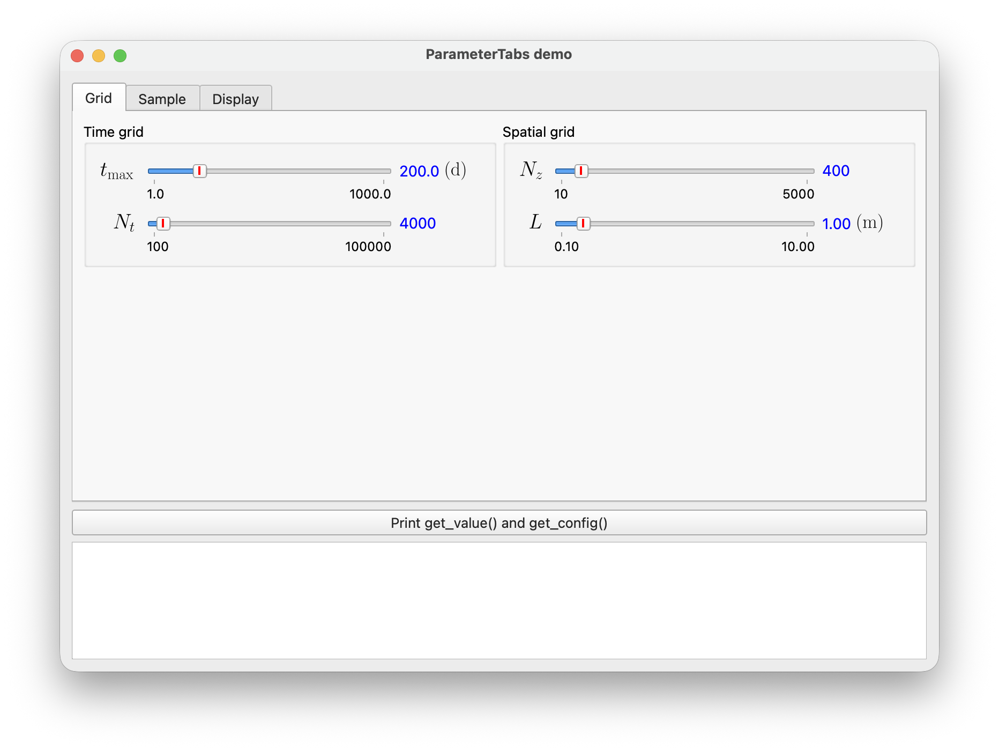

# Parameter panels

Build a whole panel of parameter widgets — groups, columns, tabs — from a
plain description, for example a section of a JSON settings file, and read or
restore all of its values as one dict. Import from `sciwidgets.panel`.



Run `python -m sciwidgets.panel` to try it.

## A single widget

A widget is described by its `"type"` and its constructor arguments, under the
same names as in Python:

```python
from sciwidgets.panel import widget_from_spec

slider = widget_from_spec({
    "type": "float-slider", "label": "t_0", "unit": "\\mathrm{s}",
    "min_val": 0, "max_val": 10, "init_val": 2.5, "val_fmt": "{:.2f}",
})
```

| Type | Widget |
|------|--------|
| `float-slider`, `int-slider` | `FloatSlider`, `IntSlider` |
| `array-slider` | `ArraySlider` |
| `float-range-slider` (or `range-slider`), `int-range-slider` | `FloatRangeSlider`, `IntRangeSlider` |
| `multi-slider` | `MultiVariableSlider` |
| `line-edit`, `combo-box`, `toggle` | `ParameterLineEdit`, `ParameterComboBox`, `ParameterToggle` |

Two values have a JSON form: `"orientation": "h"` or `"v"`, and `"features"`
as a name or a list of names (`["defaults", "config"]`, see
[sliders](sliders.md#menu-features)).

A misspelled key fails with the constructor's own message, which usually
suggests the right name:

```
TypeError: float-slider at 'grid.t_max': FloatSlider.__init__() got an unexpected keyword argument 'maxval'. Did you mean 'max_val'?
```

## A page

`ParameterPage` lays widgets out from a nested description. Every widget needs
a `"path"`, its id within the panel:

```python
from sciwidgets.panel import ParameterPage

page = ParameterPage({"column": [
    {"group": "Time grid", "column": [
        {"type": "float-slider", "path": "grid.t_max", "label": "t_\\mathrm{max}",
         "min_val": 1, "max_val": 1000, "init_val": 200},
        {"type": "int-slider", "path": "grid.nt", "label": "N_t",
         "min_val": 100, "max_val": 100000, "init_val": 4000}]},
    {"row": [
        {"type": "toggle", "path": "normalize", "text": "Normalize"},
        {"stretch": 1}]}
]})
```

| Item | Meaning |
|------|---------|
| `{"column": [...]}` | items stacked vertically; the name and value columns of the widgets directly in it line up |
| `{"row": [...]}` | items side by side |
| `{"group": "Title", "column": [...]}` | a titled box (also with `"row"`) |
| `{"stretch": n}` | on its own: empty space; on any other item: that item's share of free space |

Content starts at the top. A page does not scroll: its minimum size is what
its widgets need, so all parameters are always visible.

## Tabs

`ParameterTabs` puts several pages in tabs. Paths are unique across all tabs:

```python
from sciwidgets.panel import ParameterTabs

tabs = ParameterTabs({"tabs": [
    {"id": "grid", "title": "Grid", "layout": {"column": [...]}},
    {"id": "sample", "title": "Sample", "layout": {"column": [...]}},
]})
tabs.set_tab_enabled("sample", False)
```

Other tab methods: `tab_ids()`, `page(id)`, `set_tab_visible`,
`set_current_tab`, `current_tab()`.

## Values, configuration and signals

Pages and tabs read and write everything as flat dicts keyed by path:

```python
values = tabs.get_value()      # {"grid.t_max": 200.0, "grid.nt": 4000, ...}
config = tabs.get_config()     # {"grid.t_max": {"min_val": 1.0, "max_val": 1000.0, ...}, ...}

tabs.set_config(config)        # restore the configuration first,
tabs.set_value(values)         # then the values

tabs.valueChanged.connect(lambda path, value: ...)
tabs.configChanged.connect(lambda path, config: ...)
```

The same rules as for the widgets hold: the signals are for user actions only,
the setters are silent, and setters ignore paths they don't know, so a file
saved by an older version still loads.

Single widgets: `paths()`, `get_widget(path)`, `items()`,
`set_widget_visible(path, bool)`, `set_widget_enabled(path, bool)`.

## Shorter descriptions

**Templates** describe a widget once; each use adds or overrides keys. Nested
dicts merge key by key:

```json
{
  "templates": {
    "window": {"type": "range-slider", "min_val": 0, "max_val": 100,
               "init_vals": [10, 60], "val_fmt": "{:.1f}"}
  },
  "tabs": [{"id": "display", "title": "Display", "layout": {"column": [
    {"template": "window", "path": "display.t", "label": "t"},
    {"template": "window", "path": "display.f", "label": "F", "max_val": 50}
  ]}}]
}
```

A template can itself use `"template"` to build on another one.

**Defaults** on a container apply to every widget inside it, nested containers
included; next to `"tabs"`, they apply to the whole panel. A key reaches only
the widgets that accept it, so `{"val_fmt": "{:.3S}"}` sets the sliders and
skips the toggles:

```json
{"group": "Range", "defaults": {"val_fmt": "{:.3S}", "use_margins": true}, "column": [...]}
```

The most specific value wins: template, then outer defaults, then inner
defaults, then the widget's own keys. A defaults key that no widget accepts is
reported as an error, which catches typos.

## Your own widget types

Any `ParameterWidgetBase` subclass can be used in descriptions once
registered. The description's keys are passed to its constructor:

```python
from sciwidgets.panel import register_type

register_type("pulse", PulseWidget)
```

```json
{"type": "pulse", "path": "pump.pulse1", "amplitude": 1.0, "width": 10.0}
```

A constructor with `**kwargs` receives every key, including any defaults.
