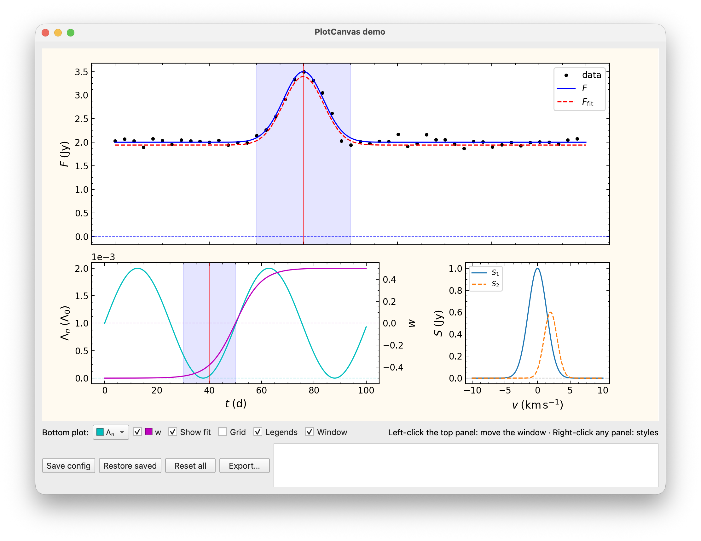

# Plot canvas

A Matplotlib canvas for Qt windows, built from a plain description of panels
and curves — for example a section of a JSON settings file. The app then only
feeds data by curve id. Import from `sciwidgets.plot`.



Run `python -m sciwidgets.plot` to try it: right-click any panel for the style
menu, left-click the top panel to move the highlighted window.

## A first canvas

```python
from sciwidgets.plot import PlotCanvas

canvas = PlotCanvas({
    "layout": {"mosaic": [["flux"], ["profile"]], "height_ratios": [3, 1], "sharex": True},
    "styles": {"data": {"linestyle": "", "marker": "o", "markersize": 3, "color": "k"},
               "model": {"linewidth": 1.25}},
    "panels": {
        "flux": {
            "primary": "flux",
            "legend": {"loc": "upper right"},
            "curves": {
                "data": {"label": "data", "style": "data"},
                "flux": {"label": "F", "unit": "Jy", "style": "model", "props": {"color": "b"}},
            },
        },
        "profile": {
            "x": {"label": "t", "unit": "d"},
            "curves": {"pump": {"label": "\\Lambda", "style": "model"}},
        },
    },
})
layout.addWidget(canvas)

canvas.set_curve_data("data", t_obs, f_obs)
canvas.set_curve_data("flux", t, f)
canvas.redraw()
```

Labels and units are math text without `$`; the y axis above reads
`F (Jy)`. Pass `usetex=True` to render them with your system LaTeX.

## Layout

| Key | Meaning |
|-----|---------|
| `mosaic` | rows of panel ids, `"."` for an empty cell; a panel spanning two cells is just its id twice, e.g. `[["flux", "flux"], ["profile", "spectrum"]]` |
| `height_ratios`, `width_ratios` | relative sizes of rows and columns |
| `hspace`, `wspace` | spacing between panels |
| `sharex` | `true` for all panels, or a list of panel ids; only the lowest shared panel shows x tick labels |

`figure` takes Matplotlib `Figure` arguments (`figsize`, `dpi`, `facecolor`,
...) and `margins` (`left`, `right`, `bottom`, `top`).

## Panels and curves

| Panel key | Meaning |
|-----------|---------|
| `curves` | `{id: {...}}`, see below; ids are unique across the figure |
| `x`, `y` | `{"label", "unit", "scale", "lim"}` |
| `primary` | the curve whose colour the zero line and the horizontal grid take, and whose label names the y axis (unless `y` has a label) |
| `select` | `"one"`: one curve at a time, see below |
| `legend` | Matplotlib legend arguments; no key, no legend |
| `zero_line` | draw a line at y = 0 (default `true`) |
| `grid` | line properties of the horizontal grid lines |
| `twin` | a second axis sharing the panel, see below |

| Curve key | Meaning |
|-----------|---------|
| `label`, `unit` | math text for the axis label |
| `legend` | legend text (default: the label) |
| `name` | plain text for menus and selectors (default: the id), e.g. `"Λₙ"` |
| `style` | a named style from `styles` |
| `props` | Matplotlib line properties, overriding the style |

**One curve at a time.** With `"select": "one"`, a panel shows a single curve;
`select_curve(panel, id)` switches, `None` shows none and hides the axis
numbers. The shown curve is the primary one, so label, zero line and grid
follow it. A `CurveSelector` (below) does this from a combo box.

**Twins.** `"twin": {"curves": {...}}` adds a y axis on the right
(`"axis": "x"`, the default) or an x axis on top (`"axis": "y"`). A twin takes
`curves`, `x`/`y`, `primary`, `select`, `zero_line` and `grid` like a panel and
is addressed as `"<panel>.twin"`, e.g. `set_limits("profile.twin", y=(-1, 1))`.

## Markers

Lines and bands across panels, e.g. to highlight a time window:

```json
"markers": {
  "window": {"kind": "vspan", "panels": ["flux", "profile"], "at": [30, 50],
             "props": {"color": "b", "alpha": 0.1}},
  "center": {"kind": "vline", "panels": "all", "at": 40, "props": {"color": "r"}}
}
```

Kinds: `vline`, `hline` (a position) and `vspan`, `hspan` (`[lo, hi]`);
`"panels": "all"` means every panel, not the twins. Move one with
`set_marker("window", (60, 80))`; also `add_marker`, `set_marker_visible`,
`remove_marker`.

## Methods

| Method | Meaning |
|--------|---------|
| `set_curve_data(id, x, y)`, `clear_curve(id)` | data |
| `set_curve_visible(id, bool)`, `select_curve(panel, id)` | visibility |
| `set_axis_visible(panel, bool)` | show or hide a whole panel or twin |
| `set_curve_style(id, **props)`, `get_curve_style(id)` | colour, line, marker |
| `set_limits(panel, x=..., y=...)`, `get_limits(panel)` | axis limits |
| `set_label(panel, "x" or "y", label, unit)` | axis label |
| `set_grid(panel, visible, which="major", direction="y")` | grid lines |
| `set_legend_visible(panel, bool)` | legend |
| `export(path)` | save as PDF, PNG, SVG, ... (from the extension) |
| `redraw()` | schedule a redraw after changes |
| `axes(panel)`, `line(id)` | the Matplotlib objects, for anything else |

For a figure of your own (e.g. a report page), `style_axes(ax)` gives any
axes the canvas' look and returns its zero line.

## Shared axis style

Ticks point inwards on all sides with minor ticks, y numbers use scientific
notation with an offset when large or small. `axes_style` overrides single
keys of `DEFAULT_AXES_STYLE`:

```json
"axes_style": {
  "label_font": {"fontsize": 13, "fontname": "Times New Roman"},
  "ticks": {"labelsize": 11, "right": false},
  "zero_line": {"color": "k", "linestyle": "--", "alpha": 0.6}
}
```

## What the user changes, and saving it

Right-clicking a panel opens a menu: the style of the curve under the mouse,
every curve's style (colour, line, width, marker, size) and visibility, grids
and the legend, each curve with its colour swatch. `context_menu=False` turns
the menu off.

`get_config()` returns only what differs from the description, as plain data
you can store (e.g. in `QSettings` as JSON):

```python
{"curves": {"flux": {"color": "#d62728", "linewidth": 2.0}, "fit": {"visible": False}},
 "axes": {"flux": {"y_major": True}, "spectrum": {"legend": False}}}
```

`set_config(cfg)` restores it, `reset_config()` returns to the description.
As with the parameter widgets, `configChanged` is emitted for user changes only,
setters are silent, and unknown curves or keys are ignored, so a saved config
still loads after the description changes. Selection, limits and twin
visibility are not part of it; they belong to the app.

## Selector and check box

```python
from sciwidgets.plot import CurveCheckBox, CurveSelector

profile = CurveSelector(canvas, "profile", none_text="None")   # select: one panel
show_w = CurveCheckBox(canvas, "w", axis="profile.twin")         # hides the twin
```

Both show each curve's colour and follow colour changes. `CurveSelector`
emits `curveSelected(id)` when the user chooses; `set_current(id)` is silent.
