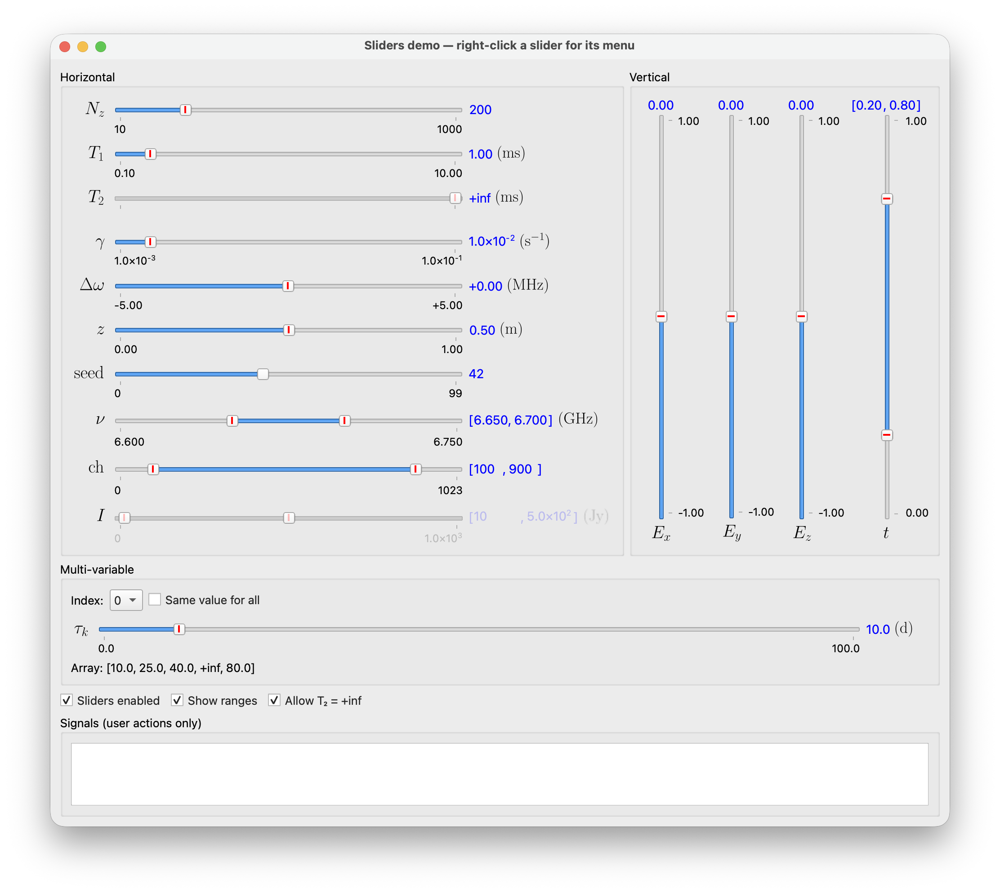

# Sliders

Labeled sliders for numeric parameters: a LaTeX name on the left, the slider in
the middle, the current value and unit on the right, and optional range labels
underneath. All of them are imported from `sciwidgets.params`.



| Slider | Value | Use it for |
|--------|-------|------------|
| `FloatSlider` | `float` (or `±inf`) | a single real parameter |
| `IntSlider` | `int` (or `±inf`) | counts, grid sizes, indices |
| `ArraySlider` | `{"arr_length", "index"}` | picking one point of an evenly spaced grid |
| `FloatRangeSlider` | `{"use_margins", "range", "margins"}` | an interval, e.g. a plot axis or a frequency band |
| `IntRangeSlider` | same as above, with `int` bounds | an integer interval, e.g. channels |
| `MultiVariableSlider` | `float` for the selected index, array via `get_arr_values()` | one value per component, edited one at a time |

Run `python -m sciwidgets.params.sliders` to try all of them.

## Before you start

Apply the style once, right after creating the application. Without it,
clicking the groove does not move the handle there and disabled sliders look
wrong:

```python
from sciwidgets.style import apply_sci_style

apply_sci_style(app)
```

## Common arguments

Every slider accepts these keyword arguments:

| Argument | Meaning |
|----------|---------|
| `label` | Name in LaTeX math mode, without `$`: `"T_1"`, `r"\Delta\omega"` |
| `unit` | Unit in LaTeX, shown in parentheses: `r"\mathrm{ms}"`. Empty for none |
| `min_val`, `max_val` | The slider's current range. The user can change it with *Edit Configuration…* |
| `val_fmt` | Display format, e.g. `"{:.2f}"`, `"{:d}"`. Values are rounded to this format |
| `show_range` | Show the min/max labels under the slider. Change later with `set_show_range()` |
| `orientation` | `Qt.Horizontal` (default) or `Qt.Vertical` |
| `features` | Which right-click menu items exist, see [Menu features](#menu-features) |
| `parent` | Parent widget |

The numeric sliders (`FloatSlider`, `IntSlider`, the range sliders and
`MultiVariableSlider`) also take hard limits that the user can never cross,
not even through *Edit Configuration…*:

| Argument | Meaning |
|----------|---------|
| `min_limit`, `max_limit` | Hard bounds, or `None` for none |
| `min_limit_inclusive`, `max_limit_inclusive` | Whether the bound itself is allowed (default `True`) |

### Scientific format

The custom format type `S` shows values as mantissa × 10ⁿ:

```python
FloatSlider(label=r"\gamma", min_val=1e-3, max_val=1e-1, init_val=1e-2, val_fmt="{:.2S}")
# shows 1.0×10⁻²
```

The number after the dot is the number of significant digits.

## FloatSlider and IntSlider

```python
from sciwidgets.params import FloatSlider, IntSlider

t1 = FloatSlider(
    label="T_1", unit=r"\mathrm{ms}",
    min_val=0.1, max_val=10.0, init_val=1.0, val_fmt="{:.2f}",
    min_limit=0.0, min_limit_inclusive=False,   # T1 > 0
)
n_z = IntSlider(label="N_z", min_val=10, max_val=1000, init_val=200)
```

`init_val` defaults to the middle of the range.

**Infinity.** A value of `"+inf"` or `"-inf"` puts the slider into a locked
"infinite" state, useful for parameters such as "no dephasing":

```python
t2 = FloatSlider(label="T_2", min_val=0.1, max_val=10.0, init_val="+inf", min_limit=0.0)
t2.get_value()            # math.inf
t2.get_special_value()    # "+inf"
t2.set_value(2.5)         # back to a finite value
```

`+inf` is only possible without a `max_limit`, and `-inf` only without a
`min_limit`. You can switch the option off at runtime with
`set_special_value_allowed("+inf", False)`.

**Useful methods:** `get_value()`, `set_value(v)`, `get_default_value()`,
`set_default_value(v)`, `set_range(min, max)`, `get_config()`,
`set_config(cfg)`.

## ArraySlider

Moves through `arr_length` evenly spaced values between `min_val` and
`max_val`. The value is the selected index:

```python
from sciwidgets.params import ArraySlider

z = ArraySlider(label="z", unit=r"\mathrm{m}", arr_length=51, min_val=0.0, max_val=1.0, init_index=25)
z.get_value()   # {"arr_length": 51, "index": 25}
```

Only the `DEFAULTS` and `CONFIG` menu features apply to it.

## FloatRangeSlider and IntRangeSlider

Two handles select an interval:

```python
from sciwidgets.params import FloatRangeSlider

band = FloatRangeSlider(
    label=r"\nu", unit=r"\mathrm{GHz}",
    min_val=6.60, max_val=6.75, init_vals=(6.65, 6.70), val_fmt="{:.3f}",
)
band.get_value()
# {"use_margins": False, "range": (6.65, 6.7), "margins": (10, 10)}
```

The value is a **dict**, not a tuple, because a range slider has two modes:

- **values mode** (`use_margins=False`): the handles define the interval, read
  it from `value["range"]`;
- **margins mode** (`use_margins=True`): the handles are disabled, and your app
  computes the interval from its data plus `value["margins"]`, the lower and
  upper margins in percent. This is handy for plot axes that should follow the
  data.

The user switches modes from the right-click menu (*Use Values* / *Use
Margins*). To set only part of the value, pass just those keys:

```python
band.set_value({"range": (6.66, 6.69)})
band.set_value({"use_margins": True, "margins": (5, 5)})
```

`init_vals` defaults to 25 % and 75 % of the range.

## MultiVariableSlider

Stores one value per component, for example the decay time of each spectral
component, and shows one of them at a time:

```python
from sciwidgets.params import MultiVariableSlider

tau = MultiVariableSlider(
    label=r"\tau_k", html_label="τ<sub>k</sub>", unit=r"\mathrm{d}",
    min_val=0.0, max_val=100.0, init_vals=[10, 25, 40, "+inf", 80],
    val_fmt="{:.1f}", min_limit=0.0,
)
tau.set_index(3)          # show and edit component 3
tau.get_arr_values()      # array([10., 25., 40., inf, 80.])
tau.set_use_same_values(True)   # all components follow the selected one
```

`html_label` is used in the *Show Values…* table, where LaTeX is not
available. Besides the usual signals it emits `arrayChanged` with a copy of the
whole array whenever the user changes any entry.

Other methods: `get_index()`, `set_arr_values(values)`, `get_arr_length()`,
`set_arr_length(n)`, `get_value_text(i)`.

## Menu features

`features` controls which items the right-click menu offers. Combine flags
with `|`:

```python
from sciwidgets.params import SliderFeature

FloatSlider(..., features=SliderFeature.DEFAULTS | SliderFeature.SET_VALUE)
```

| Flag | Menu items |
|------|------------|
| `DEFAULTS` | *Save as Default*, *Reset to Default*, and the red default marker |
| `SET_VALUE` | *Set Value…* (*Set Values…* on range sliders) |
| `CONFIG` | *Edit Configuration…* (range and format) |
| `SPECIAL` | *Set Value to +inf / −inf* |
| `VALUES` | *Show Values…* (`MultiVariableSlider` only) |
| `MARGINS` | *Use Values*, *Use Margins*, *Set Margins…* (range sliders only) |
| `ALL` | everything (the default) |
| `NONE` | no menu |

Flags that do not apply to a slider are ignored. In a JSON settings file you
can write the names instead and convert them with
`SliderFeature.from_json(["defaults", "set_value"])`.

## Signals

| Signal | Emitted when the user… | Argument |
|--------|------------------------|----------|
| `valueChanged` | moves the slider, sets a value, switches mode | the new value (same as `get_value()`) |
| `defaultChanged` | saves a new default | the new default |
| `configChanged` | changes range or format | the new config (same as `get_config()`) |
| `arrayChanged` | changes any entry (`MultiVariableSlider` only) | copy of the array |

These signals fire **only for user actions**. Calling `set_value`,
`set_config`, `set_range` and similar methods from code is silent, so loading
saved parameters does not trigger your handlers. If a setter may also change
something else (for example, a new range clamps the value), read both back
afterwards:

```python
slider.set_config(saved_config)
value = slider.get_value()     # may have been clamped to the new range
config = slider.get_config()
```

## Aligning sliders in a panel

Several sliders stacked in one panel line up when they share the same name and
value column widths:

```python
def align(sliders):
    name_w = max(s.get_name_width() for s in sliders)
    value_w = max(s.get_value_width() for s in sliders)
    for s in sliders:
        s.set_name_width(name_w)
        s.set_value_width(value_w)

for s in sliders:
    s.nameWidthChanged.connect(lambda _: align(sliders))
    s.valueWidthChanged.connect(lambda _: align(sliders))
align(sliders)
```

## Saving and restoring

`get_value()` and `get_config()` return plain Python values and dicts, so they
can be stored as JSON. Infinite values come back as `math.inf`; write them as
the strings `"+inf"` / `"-inf"` in JSON, since JSON has no infinity, and pass
the strings straight to `set_value`. Restore the config before the value, so
the value is checked against the right range:

```python
slider.set_config(data["config"])
slider.set_value(data["value"])
```