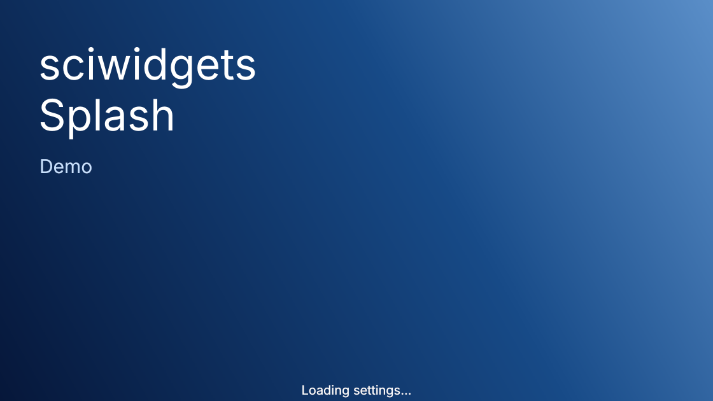

# Splash screen

A start-up splash screen: your picture with the app's name and version drawn
on it, and progress messages at the bottom. Import it from `sciwidgets.splash`.
The name and version are drawn by the widget, so a new version or name never
needs a new picture.



Run `python -m sciwidgets.splash` to see it.

## Use

```python
from PySide6.QtWidgets import QApplication
from sciwidgets.splash import SplashScreen, splash_message

app = QApplication([])
splash = SplashScreen(
    "artwork.png",                 # a file path or a QPixmap
    size=(560, 315),               # shown size in screen points
    title="My\nApp",               # one line per \n
    subtitle="Version 1.2.0",
)
splash_message("Loading data...")  # from anywhere in the app

window = MainWindow()
window.show()
splash.finish(window)              # closes the splash once the window is up
```

Create the `QApplication` first. The splash shows itself right away (pass
`show=False` to show it later with `splash.show()`).

`splash_message(text)` shows `text` on the current splash and does nothing
when there is none, so modules can report progress without passing the
splash around and still work when the app starts without one.
`SplashScreen.current()` returns the splash being shown, or `None` after
`finish()`. `splash.show_message(text)` does the same on a given splash.

## Picture and layout

The picture fills `size`; if its shape differs, its centre is kept. It is
scaled for the screen's pixel ratio, so it stays sharp on Retina screens. Use
a picture at least twice `size` for that, e.g. 1120 × 630 or larger for the
default 560 × 315.

The title sits at the top left, the subtitle below it, and messages at the
bottom. Text sizes and positions are fractions of the height, so the layout
looks the same at any size. Leave room at the top left of your picture.

## Options

| Argument | Default | Meaning |
|----------|---------|---------|
| `image` | — | picture file (`str` or `Path`) or `QPixmap` |
| `size` | `(560, 315)` | shown size `(width, height)` |
| `title` | `""` | text at the top left, one line per `\n` |
| `subtitle` | `""` | smaller text below the title |
| `font_family` | app font | font for title, subtitle and messages |
| `title_color` | white | colour of the title |
| `subtitle_color` | light blue | colour of the subtitle |
| `message_color` | white | colour of the messages |
| `message_font_size` | `15` | point size of the messages |
| `message_alignment` | bottom centre | where messages appear (`Qt.AlignmentFlag`) |
| `delay` | `0` | seconds each message stays before the app continues, to make a fast start-up readable |
| `click_to_close` | `False` | whether a click closes the splash |
| `stay_on_top` | `True` | keep the splash above other windows |
| `show` | `True` | show the splash right away |

Colours accept a `QColor`, a `Qt` colour or a name such as `"#c8e1ff"`.
`SplashScreen` raises `RuntimeError` without a `QApplication` and
`ValueError` if the picture cannot be loaded.
