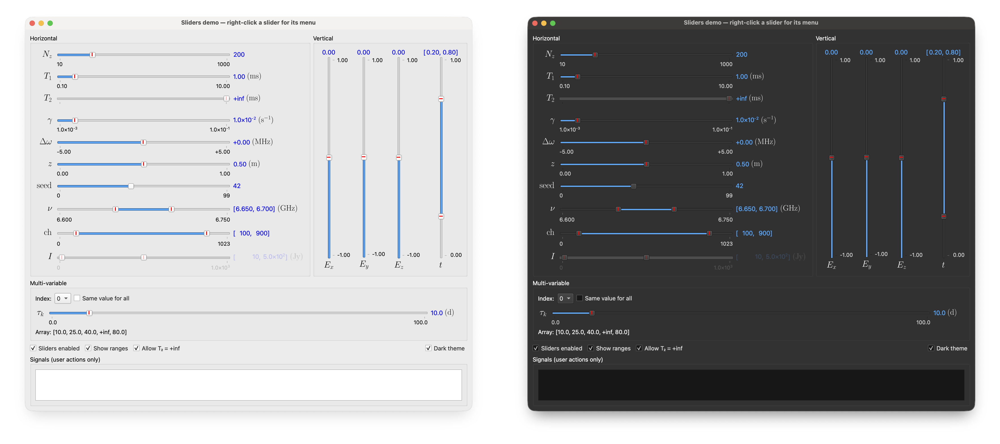

# Style and formatting

Two small modules the widgets rely on: `sciwidgets.style`, which every app
using sciwidgets must apply once, and `sciwidgets.formatting`, the number
formatting behind the `S` format.

## Applying the style

```python
import sys

from PySide6.QtWidgets import QApplication
from sciwidgets.style import apply_sci_style

app = QApplication(sys.argv)
apply_sci_style(app)
```

`apply_sci_style(app, extra_style_sheet="")` does two things:

1. **Sets `SciStyle`**, a Qt style based on Fusion. The widgets depend on it
   for part of their behaviour:
   - clicking a slider groove moves the handle to that spot, instead of
     stepping towards it;
   - disabled sliders get a flat grey groove;
   - a line edit with invalid input gets a red frame (used by
     `NumericLineEdit`).
2. **Sets a style sheet** with the fonts and colors the widgets expect: slider
   values in blue, range labels slightly smaller, and blue text in line
   edits and spin boxes. Disabled widgets get a faded version of each color.
   With a dark palette the blue is a lighter one (`#5aa9ff`) and the range
   labels light grey.

Without the style the widgets still work, but they behave and look different.

### Your own style sheet

Qt keeps only one application style sheet: a later `app.setStyleSheet(...)`
replaces the sciwidgets rules. Pass your rules to `apply_sci_style` instead,
and they are appended after the sciwidgets rules:

```python
my_rules = "QGroupBox { font-weight: bold; } QStatusBar { border-top: 1px solid #999; }"
apply_sci_style(app, my_rules)
```

If you build the style sheet yourself, include `sci_style_sheet(app)`:

```python
from sciwidgets.style import SciStyle, sci_style_sheet

app.setStyle(SciStyle())
app.setStyleSheet(sci_style_sheet(app) + my_rules)
```

Font sizes in the sciwidgets rules are relative to the application font, so
set `app.setFont(...)` **before** applying the style.

The line-edit and spin-box rules apply to every `QLineEdit` and `QSpinBox` in
the application, not only to those inside sciwidgets widgets. Override them in
your own rules if other fields should look different.

## Light and dark mode



The widgets follow the application palette. Math labels (slider names, units,
parameter labels) take the palette's text color, the style sheet picks its
colors for a light or a dark palette, and a disabled slider groove is drawn in
greys that suit the background. When the palette switches, for example when
macOS changes appearance while the app is open, `apply_sci_style` sets the
style sheet again by itself and the labels redraw.

To force a scheme, or to offer a choice in a menu:

```python
from sciwidgets.style import color_scheme, is_dark, set_color_scheme

set_color_scheme(app, "dark")    # or "light", or "system" to follow the system again
is_dark()                        # True when the application palette is dark
color_scheme()                   # the last choice: "light", "dark" or "system"
```

`set_color_scheme` asks Qt for the scheme (Qt 6.8 and later; on macOS this
switches the whole app, native dialogs included). Where the platform gives no
dark palette, it sets `dark_palette()`, a palette close to macOS Dark Mode.
The `python -m sciwidgets.params` and `python -m sciwidgets.params.sliders`
demos have a **Dark theme** check box.

### The widgets' own colors

Four colors are the widgets' own, each with a light and a dark version:

| Name | Default (light, dark) | Used for |
|------|-----------------------|----------|
| `value` | blue, `#5aa9ff` | slider values; text in line edits and spin boxes |
| `range_label` | black, `#d0d0d0` | the min/max labels under sliders |
| `marker` | red, `#ff6b6b` | the default-value tick on sliders |
| `invalid` | `#d32f2f`, `#ff6b6b` | the frame around invalid input |

Change them for the whole app, once at start-up or at any time:

```python
from sciwidgets.style import apply_sci_style, set_sci_colors

apply_sci_style(app, my_rules, colors={"value": ("#0055cc", "#6cb4ff")})
set_sci_colors(app, marker="green")          # one color for both modes
set_sci_colors(app, value="accent")          # the system accent color (macOS)
set_sci_colors(app, value=None)              # back to the default
```

`"accent"` is the palette's highlight color: on macOS the accent color chosen
in System Settings → Appearance, which also fills the slider grooves.
`sci_color(name)` returns a color for the current mode.

Colors you pass yourself (a label's `text_color`, a slider's marker color)
stay as they are in both schemes. Plots and tables follow dark mode too (see
[plot](plot.md#light-and-dark-mode) and [table](table.md#light-and-dark-mode));
your own style sheet is not changed: check it in dark mode separately.

`sciwidgets.colors` has the colour rules they use, for an app's own drawing:
`dark_variant(color)` (a line or text colour readable on a dark background),
`dark_fill(color)` (a background fill for dark mode), `readable_text(fill)`
(black or white) and `contrast_ratio(a, b)`.

## Number formatting

Formats are ordinary Python format strings, such as `"{:.2f}"` or `"{:d}"`,
plus one extra type, **`S`**, for scientific display. The number after the dot
is the number of significant digits:

| Value | Format | Shown as |
|-------|--------|----------|
| `12345.678` | `"{:.3S}"` | 1.23×10⁴ |
| `0.01` | `"{:.2S}"` | 1.0×10⁻² |
| `-0.002` | `"{:.3S}"` | -2.00×10⁻³ |
| `123.456` | `"{:.3S}"` | 123 |
| `50000` | `"{:.8S}"` | 50,000 |

Values between 1 and 10ⁿ (n = number of digits) are shown as plain numbers,
with thousands separators; everything else uses the ×10ⁿ form.

The functions are available directly from `sciwidgets.formatting`:

| Function | Purpose |
|----------|---------|
| `value_to_text(value, fmt)` | format a value with any format, including `S`; returns HTML for `S` |
| `pretty_sci_text(value, sig_digits=3, notation="html")` | the ×10ⁿ form; `notation` is `"html"`, `"plain"` (`1.23×10^4`) or `"latex"` |
| `format_is_valid(fmt, sample)` | check a user-entered format before using it |
| `is_sci_format(fmt)` | whether a format uses `S` |
| `get_numeric_format_field(fmt)` | the plain Python format used to round values (`S` → `g`) |

```python
from sciwidgets.formatting import pretty_sci_text, value_to_text

value_to_text(12345.678, "{:.3S} Hz")             # '1.23×10<sup>4</sup> Hz'
pretty_sci_text(6.67e-11, 3, notation="latex")    # '6.67\\times 10^{-11}'
```

Values are rounded to their display format, so what you see is exactly the
value the widget returns from `get_value()`.
