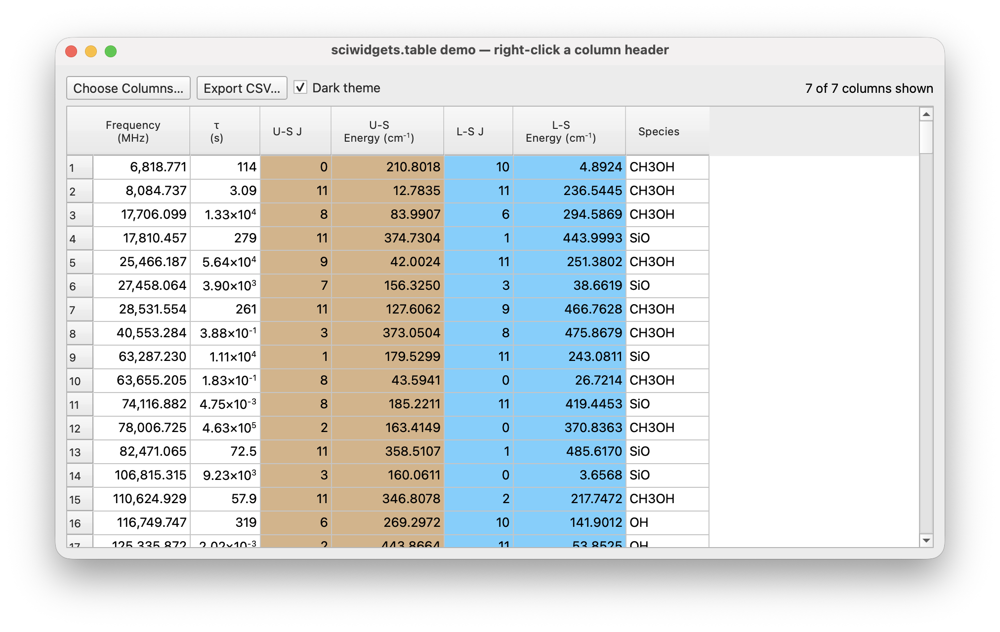

# DataFrame tables

A read-only table model over a pandas DataFrame and a `QTableView` built
around it. Import them from `sciwidgets.table`; this subpackage needs
pandas, installed with the `table` extra:

```bash
pip install "sciwidgets[table]"
```

Importing `sciwidgets.table` without pandas raises `ImportError` with that
command. The rest of sciwidgets does not need pandas.

Run `python -m sciwidgets.table` to try the view.



## DataFrameModel

```python
from sciwidgets.table import DataFrameModel

model = DataFrameModel(
    df,
    formats={"Frequency (MHz)": "{:,.3f}", "tau (s)": lambda v: f"{v:.3e}"},
    backgrounds=lambda column: "tan" if column.startswith("U-") else None,
    headers={"Frequency (MHz)": "Frequency\n(MHz)"},
)
view.setModel(model)
```

| Argument | Meaning |
|----------|---------|
| `formats` | per column, a format string (`"{:,.3f}"`) or a callable taking the value and returning text; other columns show `str(value)` |
| `backgrounds` | `{column: color}` or a callable taking the column name and returning a color or `None` |
| `row_backgrounds` | callable taking a row (`pandas.Series`) and returning its background colour or `None`; wins over the column defaults, a user column colour wins over it |
| `alignments` | `"left"`, `"center"` or `"right"` per column, as a dict or a callable taking the column name (`None` keeps the rule below) |
| `headers` | header text per column; the column name by default |
| `dark_backgrounds` | background per column in dark mode, same forms as `backgrounds`; columns not given get their light background darkened |
| `dark` | show dark-mode colours; default: whether the application palette is dark (`DataFrameView` keeps it current) |

Without an alignment, cells of numeric columns, and of columns that have a
format, are right-aligned; the others left. Row headers count from 1.

`set_frame(df)` replaces the data and keeps the formats, backgrounds and
headers; `frame()` returns the DataFrame; `columns()` the column names.

## DataFrameView

```python
from sciwidgets.table import DataFrameView

view = DataFrameView()
view.set_frame(df, formats={"nu": "{:.3f}"})   # keyword arguments go to DataFrameModel
view.set_visible_columns(["nu", "tau"])        # None shows all; the order stays the model's
view.choose_columns()                          # checkbox dialog; True when the selection changed
view.visible_frame()                           # DataFrame with the visible columns only
view.export_csv("lines.csv")                   # visible columns, index=False
```

`set_frame` resizes the columns to their contents, and fits the header to
multi-line texts with `header_padding` pixels of space around them (12 by
default; constructor argument or `set_header_padding`). Hidden columns stay
hidden across `set_frame` calls as long as they exist in the new data.
`visibleColumnsChanged(list)` is emitted when the user changes the
selection in the dialog, not by `set_visible_columns`. `model_()` returns the
`DataFrameModel` (`model()` is Qt's own method).

## Rich text

Header texts and formatted values may be HTML: `<sup>`, `<sub>`, `<br>`,
entities such as `&tau;`. Plain header texts use `\n` for line breaks.
`pretty_sci_text` from `sciwidgets.formatting` gives values like
1.33×10<sup>4</sup>:

```python
from sciwidgets.formatting import pretty_sci_text

view.set_frame(df,
               formats={"tau (s)": lambda v: pretty_sci_text(v, 3)},
               headers={"tau (s)": "&tau;<br>(s)", "E (cm^-1)": "Energy<br>(cm<sup>-1</sup>)"})
```

## Sorting

A click on a column header sorts the rows by that column, a second click
reverses the order (`DataFrameView(sortable=False)` turns this off). A text
column whose values are all numbers (a CSV read with `dtype=str`) is sorted
numerically. The sort is applied to the DataFrame itself, so `frame()`, `visible_frame()` and
`export_csv` follow it, and a later `set_frame` keeps the sort column.

## Header menu, colors, font and config

A right-click on a column header opens a menu: *Column Color…* (a color
dialog for that column), *No Column Color* (white), *Default Column Color*
(the `backgrounds` value again), *Hide This Column*, *Choose Columns…* and
*Reset Colors* (every column back to its default). A user color overrides
the `backgrounds` given to `set_frame` for that column and survives later
`set_frame` calls. *Text Color…* and *Default Text Color* do the same for
the text of that column (`text_colors` in `set_frame`, same forms as
`backgrounds`; API with `kind="text"`). *Font…* opens a font dialog for
cells and headers (`set_table_font(font | None)`, `table_font()`);
*Default Font* returns to the application font. *Alignment ▸ Left /
Center / Right / Default* overrides the alignment of that column
(`set_column_alignment(column, "left" | "center" | "right" | None)`,
`column_alignment(column)`).

The view stores nothing itself. What the user changed comes back from
`get_config()` — `{"backgrounds": {column: "#rrggbb" | None}, "text_colors":
{column: "#rrggbb" | None}, "alignments": {column: "left" | "center" | "right"},
"visible_columns": [...] | None, "font": "<QFont.toString()>" | None}` (`None` = no color / default font) — and `configChanged(dict)` is emitted on every user change,
so the app can keep it in `QSettings` and restore it with `set_config()`
(silent; unknown keys ignored). Programmatic counterparts:
`set_column_color(column, color | None, kind="background" | "text")`,
`restore_column_color(column, kind=...)`, `column_color(column, kind=...)`,
`reset_colors()`.

To add app-specific entries, connect to `headerMenuRequested(menu, column)`
and `menu.addAction(...)` there.

## Light and dark mode

`DataFrameView` follows the application palette by itself
(`model_().set_dark(bool)` and `model_().dark()` for a model on its own).
All colours — `backgrounds`, `text_colors`, `row_backgrounds` and the
user's — are light-mode colours. In dark mode:

- a light background is shown darkened with its hue kept (tan → dark brown,
  light blue → dark blue; `sciwidgets.colors.dark_fill`), unless
  `dark_backgrounds` gives the column its own dark colour;
- a text colour too dark for the dark table is shown lighter
  (`sciwidgets.colors.dark_variant`).

In both modes a cell with a background and no text colour of its own gets
black or white text, whichever reads better on that background
(`sciwidgets.colors.readable_text`).

