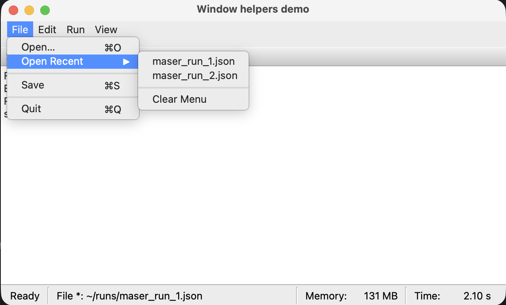

# Window helpers

Two controllers for a `QMainWindow`: a menu bar built from a plain Python
description, and a status bar that shows the current state, the document
path, the elapsed time of long tasks and the memory use. Import them from
`sciwidgets.window`.



Run `python -m sciwidgets.window` to try both.

## MenuBarController

Describe the menus as a dict and build them in one call:

```python
from PySide6.QtGui import QAction, QKeySequence
from sciwidgets.window import MenuBarController

MENUS = {
    "File": [
        {"id": "open", "text": "Open…", "shortcut": QKeySequence.Open},
        {"submenu": "Open Recent", "items": [
            {"id": "recent_1", "text": "run_1.json"},
            {"id": "sep"},
            {"id": "clear_recent", "text": "Clear Menu"},
        ]},
        {"id": "sep"},
        {"id": "quit", "text": "Quit", "shortcut": QKeySequence.Quit, "role": QAction.QuitRole},
    ],
    "View": [
        {"id": "show_grid", "text": "Show Grid", "checkable": True, "checked": True},
    ],
}

menu = MenuBarController(window, MENUS)
menu.actionTriggered.connect(on_menu_action)


def on_menu_action(menu_path: str, action_id: str, checked: bool) -> None:
    if action_id == "open":
        open_file()
    elif action_id == "show_grid":
        plot.set_grid_visible(checked)
```

### Items

| Item | Form |
|------|------|
| Action | `{"id": "save", "text": "Save", ...}` |
| Separator | `{"id": "sep"}` |
| Submenu | `{"submenu": "Title", "items": [...]}` (submenus can be nested) |

Optional keys of an action:

| Key | Meaning |
|-----|---------|
| `shortcut` | `"Ctrl+S"`, or a standard key such as `QKeySequence.Save` (adapts to each platform) |
| `checkable`, `checked` | an on/off item and its initial state |
| `enabled` | initial enabled state (default `True`) |
| `role` | macOS menu role, e.g. `QAction.QuitRole`, `QAction.AboutRole`, `QAction.PreferencesRole`; macOS moves these items to the application menu |

Every action needs an `id`, unique across the whole menu bar. A missing or
repeated id raises `ValueError` before anything is built.

### Signal

`actionTriggered(menu_path, action_id, checked)` is emitted when the user
picks an item. `menu_path` is the menu title, with submenus joined by `/`
(e.g. `"File/Open Recent"`); `checked` is the new state of a checkable item
and `False` otherwise.

### Methods

| Method | Meaning |
|--------|---------|
| `set_enabled(id, enabled)` | enable or disable an item |
| `set_checked(id, checked)` / `get_checked(id)` | set or read a checkable item (setting it does not emit `actionTriggered`) |
| `action(id)` | the item's `QAction`, e.g. to put it on a toolbar too |
| `set_menu_spec(spec, native_menubar=True)` | replace all menus |

`set_enabled`, `set_checked` and `get_checked` ignore unknown ids;
`action(id)` raises `KeyError`.

Because `action()` returns the real `QAction`, a toolbar button and its menu
item stay in sync: disabling one disables both.

```python
toolbar = window.addToolBar("Main")
toolbar.addAction(menu.action("open"))
```

`native_menubar=False` keeps the menu bar inside the window on macOS instead
of the global menu bar at the top of the screen.

## StatusBarController

```python
from sciwidgets.window import StatusBarController

status = StatusBarController(window)
status.set_path("~/runs/run_1.json")
```

The left side shows the state and the document path; the right side shows
the memory used by the process and the elapsed time of the last long task:

```
 Ready  |  Path *: ~/runs/run_1.json                    |  Memory: 143 MB  |  Time: 2.31 s
```

### States

A state is any text you choose. Pass `busy=True` when a long task starts: the
clock starts, and the next state stops it and keeps the final time visible.

```python
status.set_state("Solving…", busy=True)
# ... the task runs ...
status.set_state("Ready")
```

An `Enum` with string values works too, which keeps the texts in one place:

```python
class AppState(str, Enum):
    READY = "Ready"
    SOLVING = "Solving…"
    ERROR = "Error"

status.set_state(AppState.SOLVING, busy=True)
```

**Long tasks and the event loop.** The new state appears on screen when Qt
gets back to its event loop. A task that blocks the GUI thread right after
`set_state` would freeze the window before the state is drawn. Either run
the task in a worker thread (best: the window stays responsive and the time
counts live), or start it with a short delay so the state is drawn first:

```python
status.set_state("Importing…", busy=True)
QTimer.singleShot(50, import_data)   # import_data ends with status.set_state("Ready")
```

### Document path

| Method | Meaning |
|--------|---------|
| `set_path(path)` | show a path; a non-empty path clears the `*` (the file was just opened or saved); `""` shows `Untitled` |
| `set_modified(True/False)` | show or remove the `*` for unsaved changes |
| `is_modified()`, `get_path()`, `is_busy()` | read the current state |

### Options

| Argument | Default | Meaning |
|----------|---------|---------|
| `ready_text` | `"Ready"` | initial state text |
| `states` | `()` | all state texts you will use; the label is sized for the widest, so the path does not move |
| `show_path` | `True` | show the path section |
| `path_label` | `"Path"` | caption of the path section, e.g. `"File"` |
| `show_memory` | `True` | show the memory use |
| `show_time` | `True` | show the elapsed time |
| `timer_interval` | `700` | refresh interval of time and memory during busy states, in ms |

Memory is the process's resident memory, read with
[psutil](https://pypi.org/project/psutil/).

## center_on_screen

```python
from sciwidgets.window import center_on_screen

center_on_screen(win, (1400, 900), fallback=(1200, 700))
```

Resizes the window to `size` when that fits the available screen area,
otherwise to `fallback` (90 % of the screen by default), and moves it to the
centre of its screen.
